# British Auction RFQ System

A freight RFQ platform with British auction (reverse auction) bidding. Suppliers keep lowering their quotes. Activity close to the end extends the auction, and a forced close time caps it.

- **Live demo:** [british-auction.vercel.app](https://british-auction.vercel.app) · API: [british-auction-api-zbjx.onrender.com](https://british-auction-api-zbjx.onrender.com/api/health)
- **API docs (Swagger):** [/docs](https://british-auction-api-zbjx.onrender.com/docs) · [ReDoc](https://british-auction-api-zbjx.onrender.com/redoc) · [OpenAPI JSON](https://british-auction-api-zbjx.onrender.com/openapi.json)
- **Design docs:** [High-level design](docs/HLD.md) · [Database schema](docs/SCHEMA.md) · [Backend architecture diagram prompt](docs/BACKEND_ARCHITECTURE_PROMPT.md)


## High-level design at a glance

The full design review is in **[docs/HLD.md](docs/HLD.md)**: requirements, capacity estimates, architecture, data model, key flows, consistency, a scalability deep dive, reliability, security, observability, the roadmap and decision records. Each capability is marked **Built** (live today) or **Planned**.

| Area | Built in v1 | Planned next | HLD |
|---|---|---|---|
| Correctness | One Postgres row lock per auction; server clock decides; arrival-time stamping; status derived on read | Transactional outbox so no broadcast is ever lost | [§7](docs/HLD.md#7-consistency-and-timer-integrity-built), [§10](docs/HLD.md#10-reliability) |
| Live updates | Socket.IO pushes `{ rfqId }` only; clients refetch with their own role | Redis pub/sub adapter so broadcasts reach every API instance | [§4](docs/HLD.md#4-architecture-v1-built), [§9.4](docs/HLD.md#94-scaling-out) |
| Hot auctions (hot keys) | Lock scoped to one RFQ, millisecond transactions | Snapshot cache with request coalescing, Redis ZSET leaderboards, local cache in front of hot Redis keys, per-auction ordering at extreme load | [§9.1](docs/HLD.md#91-hot-keys-and-hot-auctions) |
| Duplicates and retries | Own-bid rule rejects repeats that aren't lower | Idempotency keys with a Bloom filter in front of an authoritative Redis check | [§9.2](docs/HLD.md#92-bloom-filters) |
| Background work | — | Celery on a Redis broker: `close_auction` jobs scheduled at the close (re-scheduled on extension), notifications, outbox relay, nightly success metrics | [§13](docs/HLD.md#13-roadmap-redis-celery-and-beyond) |
| Security | Mock `x-user-id` auth; role-shaped responses in one place; CORS locked to the frontend | OIDC/JWT, per-org tenancy, Redis token-bucket rate limits | [§11](docs/HLD.md#11-security) |

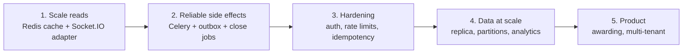

## What it does

| | Buyer | Supplier |
|---|---|---|
| Create RFQs with schedule, X/Y and trigger type | Yes | |
| See every quote ranked L1, L2, L3 with full charges | Yes | |
| Submit and lower quotes | | Yes |
| See own rank, own bids, the L1 price | | Yes |
| Live countdown, live extensions, activity log | Yes | Yes (competitors anonymized) |
| Toast notifications | New bids, extensions | Outbid, extensions, new RFQs, bid confirmations |
| Export ranked supplier list as CSV | Yes | |

**Auction rules:**
- Bids are accepted only while `start <= now < currentClose`.
- A bid inside the last **X** minutes that matches the configured trigger moves the close **Y** minutes later. The trigger is one of: any bid, any rank change, or an L1 change.
- The close never goes past the forced close time.
- Each new bid from a supplier must be lower than that supplier's previous bid.

## Screenshots

### 1. Sign in

Pick a seeded buyer or supplier (mock auth). Login is per browser tab, so a buyer and a supplier can be open side by side.

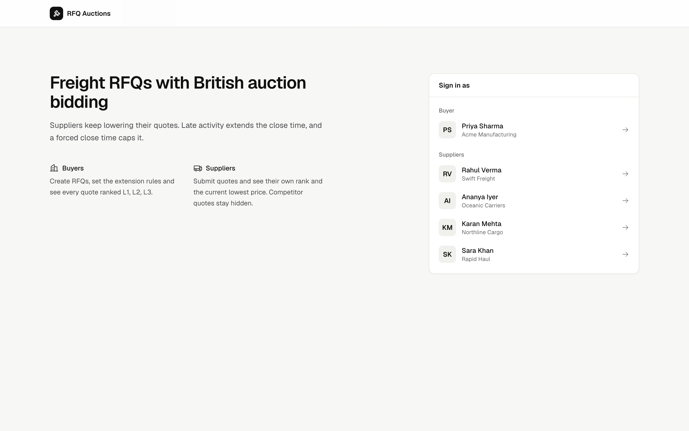

### 2. Auction listing

Every RFQ with its status (Active, Upcoming, Closed, Force closed), current lowest bid, live time left, current close time with how far it has been extended, and forced close time. Filter by status or search by name or ID.

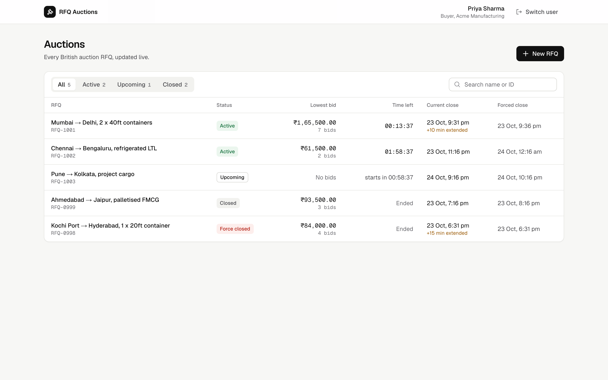

### 3. Create RFQ

Name, reference ID, pickup / service date, bid start, bid close and forced close, the trigger window (X), the extension duration (Y) and the trigger type. The side panel explains in plain words how the auction will run and how many extensions fit before the forced close. Invalid input, such as a forced close before the bid close, is flagged inline.

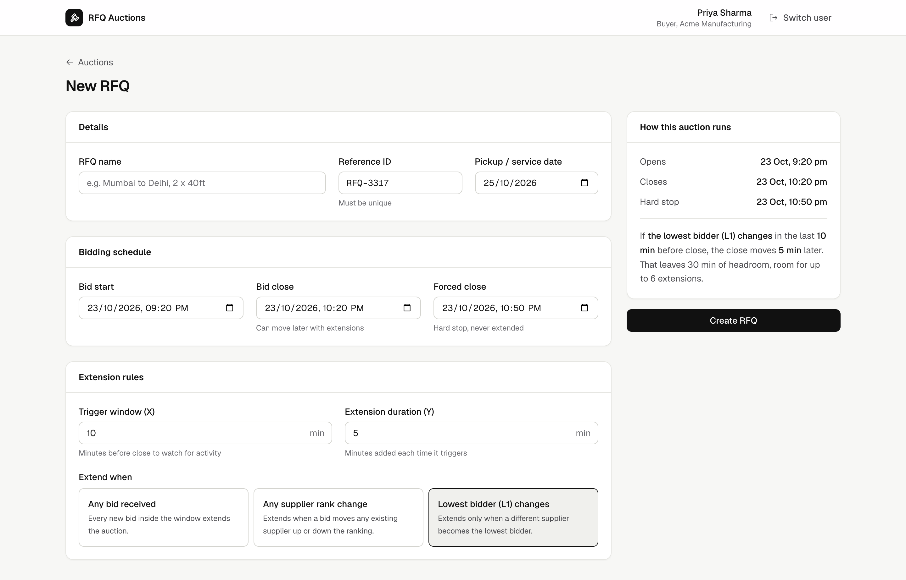

### 4. Auction details (buyer)

Live countdown, current close (original time plus extensions), forced close and L1 price. The timeline bar shows the scheduled window, the time added by extensions and the headroom left before the forced close.

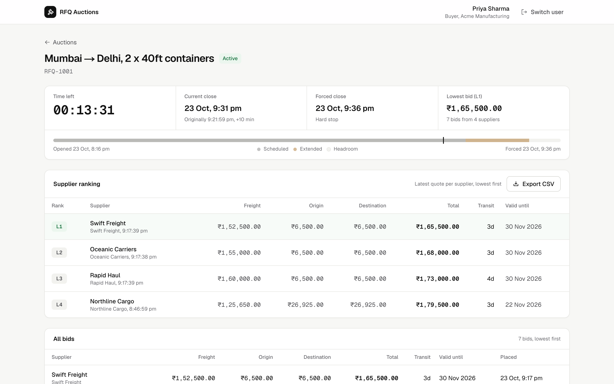

### 5. Supplier ranking and full bid history

The ranking shows each supplier's latest quote as L1, L2, L3… with every charge, transit time and quote validity, and exports to CSV. Below it, every bid ever placed, sorted by price; quotes a supplier has since lowered are marked superseded.

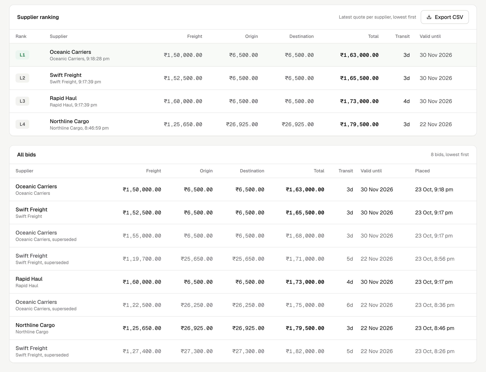

### 6. Quote submission (supplier)

A supplier sees their own rank, latest bid and gap to L1, submits or lowers a quote with a running total, and sees their own bid history. Competitors stay anonymous in the activity log.

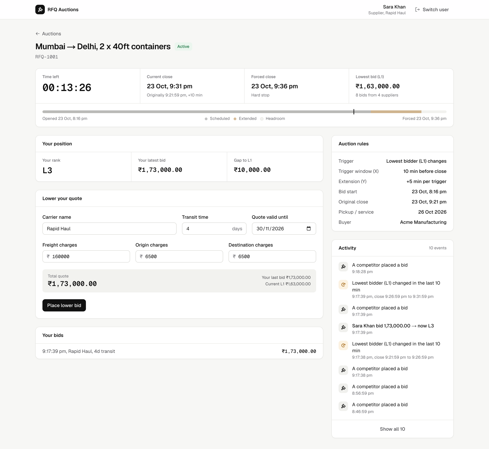

### 7. Auction rules and activity log

The configured trigger, X and Y. The activity log records every bid and every extension, with the reason (for example "L1 changed: Rahul Verma → Ananya Iyer in the last 10 min → extended by 5 min") and the old and new close times.

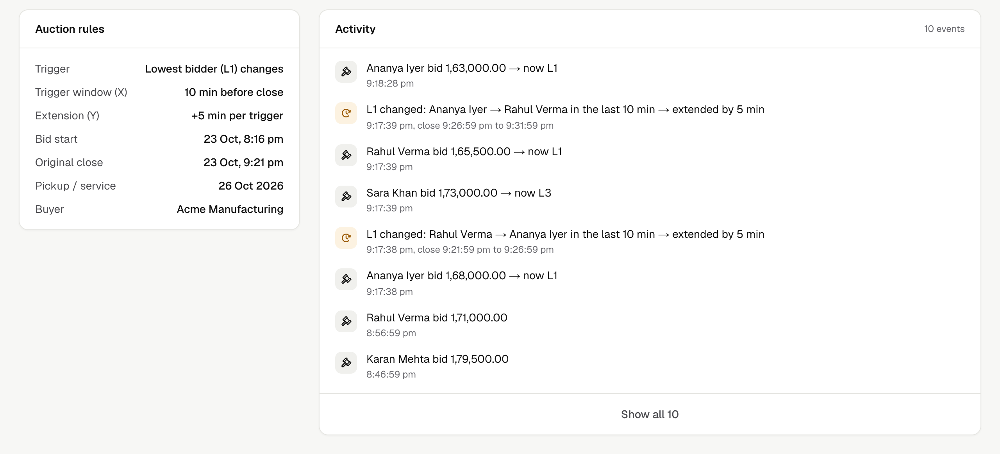

### 8. Live updates

A supplier's bid reaches every open page over WebSockets: the ranking reorders, the L1 price updates and a toast appears, with no refresh.

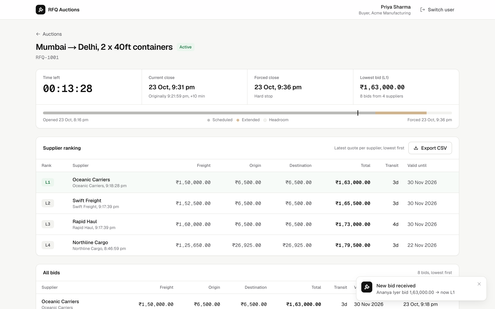

### 9. API docs (Swagger UI)

OpenAPI 3.1 docs at [`/docs`](https://british-auction-api-zbjx.onrender.com/docs): how to log in, the error format, the Socket.IO events, and every endpoint grouped by Health, Users, RFQs and Bids. Click **Authorize**, enter a user id, and use **Try it out** on any endpoint.

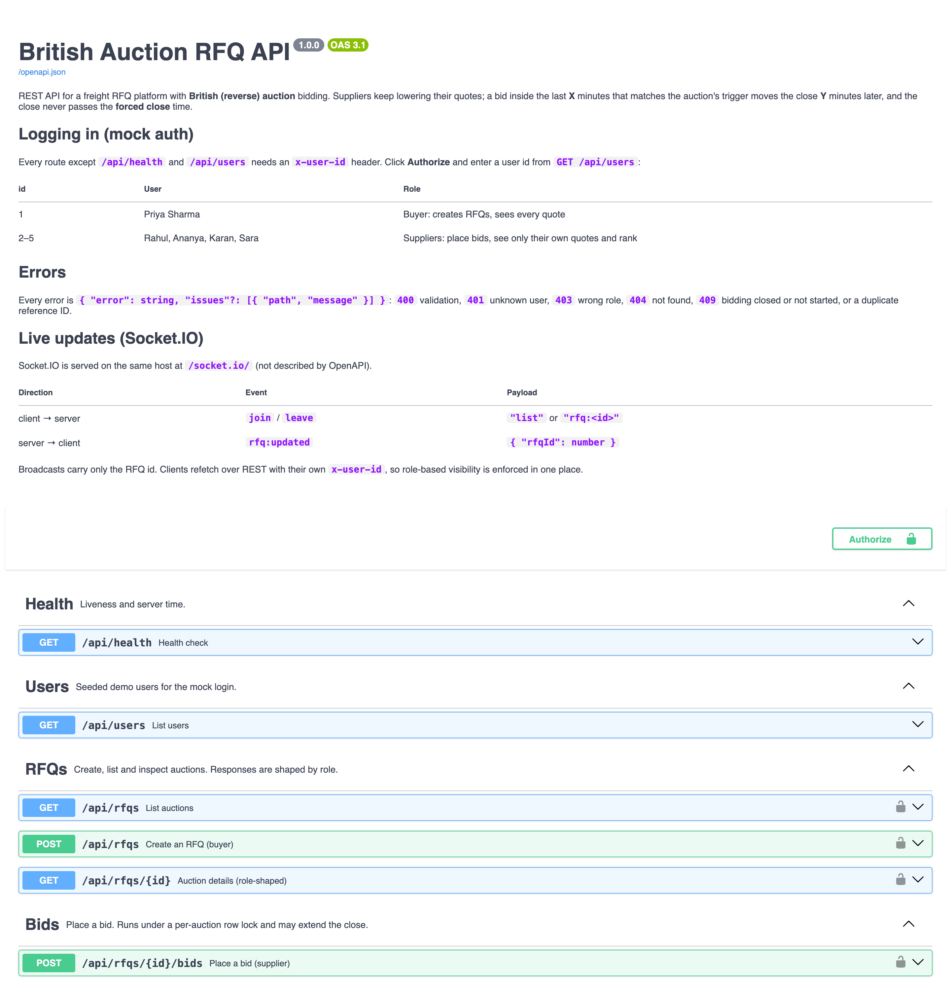

### 10. API docs: an endpoint in detail

Each endpoint lists its rules, an example request body, and every response it can return (here 201, 400, 401, 403, 404 and 409) with example bodies.

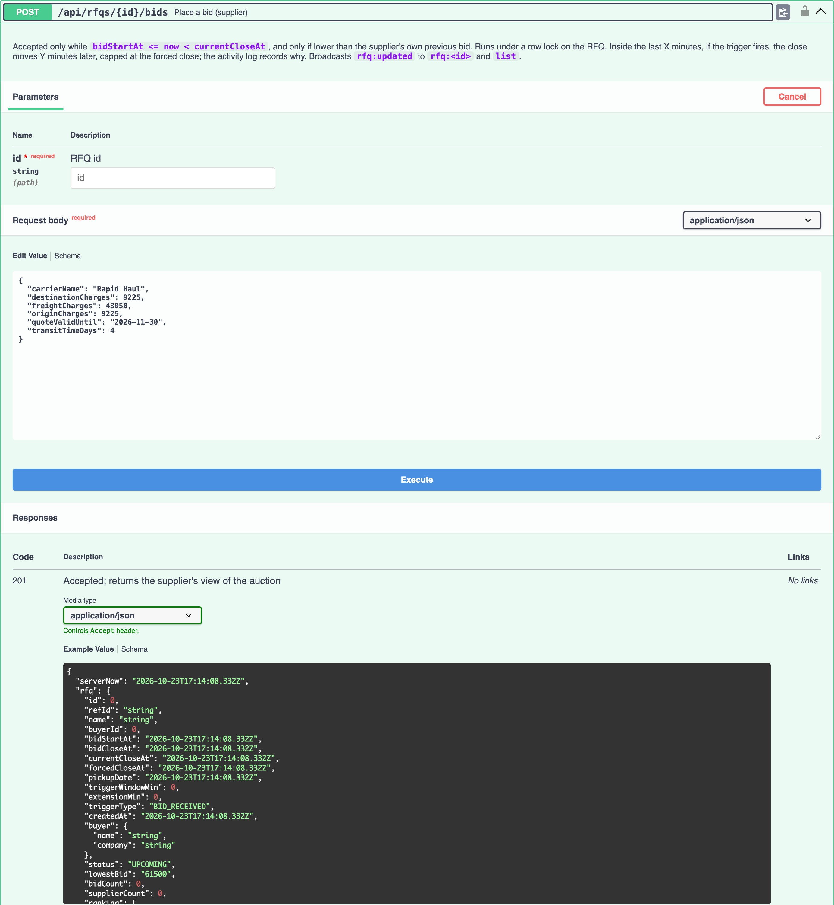

## Assignment checklist

| Requirement (from the brief) | Status | Where |
|---|---|---|
| RFQ creation: name/reference ID, bid start, bid close, forced close, pickup/service date | Done | `frontend/app/auctions/new`, `POST /api/rfqs` |
| Quote form: carrier, freight/origin/destination charges, transit time, validity | Done | `frontend/components/BidForm.tsx`, `POST /api/rfqs/:id/bids` |
| Trigger window X, extension duration Y | Done | `backend-py/app/auction.py` (`in_trigger_window`, `extend_close`) |
| Triggers: bid received, any rank change, L1 change | Done | `detect_trigger` in `backend-py/app/auction.py` |
| Forced close > bid close; extensions never exceed forced close | Done | `rfq_input` in `backend-py/app/validation.py`; `extend_close` caps with `min()` |
| Listing: name/ID, current lowest bid, current close, forced close, status | Done | `frontend/app/auctions/page.tsx` |
| Details: ranked bids L1/L2/L3, every bid sorted by price, quote details, X/Y config, activity log with extension reasons | Done | `frontend/app/auctions/[id]/page.tsx` |
| HLD with architecture diagram | Done | `docs/HLD.md`, `docs/architecture.png` |
| Schema design | Done | `docs/SCHEMA.md`, `backend-py/app/models.py`, `backend-py/alembic/versions/0001_initial.py` |
| Backend code, frontend code | Done | `backend-py/`, `frontend/` |

Beyond the brief: live updates over WebSockets, toast notifications, role-based visibility, a row lock per auction, server-synced countdowns and unit tests for the auction rules.

## Stack

| Layer | Tech | Hosting |
|---|---|---|
| Frontend | Next.js 16 (App Router), React 19, Tailwind v4, Phosphor icons, Sonner (toasts), socket.io-client | Vercel |
| Backend | Python 3.12, FastAPI, Uvicorn, python-socketio, SQLAlchemy 2 (async, asyncpg) | Render |
| Database | PostgreSQL, migrations with Alembic | Render Postgres |

Vercel can't hold WebSocket connections, so the realtime API runs on Render as a long-lived process.

```
backend-py/
  app/models.py            schema as SQLAlchemy models (deliverable)
  alembic/                 migrations (0001 creates the schema)
  app/seed.py              demo data, times relative to now
  app/auction.py           pure auction rules (ranking, triggers, extension, status)
  tests/test_auction.py    unit tests for the rules
  app/routes.py            REST API, bid transaction
  app/validation.py        request validation and error messages
  app/main.py              FastAPI + Socket.IO bootstrap
frontend/
  app/                     pages: login, listing, create, details
  components/              BidForm, shared UI
  components/LiveNotifications.tsx   app-wide toasts for auctions you are not viewing
  lib/                     API client, server-synced clock, socket hook, notify() toasts
docs/                      HLD and schema
```

## Run locally

Prerequisites: Python 3.12, Node 20+ (for the frontend), and either Docker or a local PostgreSQL.

```bash
# 1. Database (Docker; matches backend-py/.env.example)
docker compose up -d
#    or with a local Postgres: createdb british_auction, then edit DATABASE_URL in backend-py/.env

# 2. Backend (http://localhost:4000)
cd backend-py
python3.12 -m venv .venv
.venv/bin/pip install -r requirements.txt
cp .env.example .env
.venv/bin/alembic upgrade head        # create the tables
.venv/bin/python -m app.seed          # resets data: 1 buyer, 4 suppliers, 5 RFQs
.venv/bin/python -m app               # auto-reloads

# 3. Frontend (http://localhost:3000)
cd ../frontend
cp .env.example .env.local    # NEXT_PUBLIC_API_URL=http://localhost:4000
npm install
npm run dev
```

If the frontend runs on a port other than 3000, add that origin to `FRONTEND_ORIGIN` in `backend-py/.env` (comma-separated).

### Try it

1. Open the app and sign in as **Priya Sharma (buyer)**. Open `RFQ-1001`, which closes about 5 minutes after seeding and is already inside its 10-minute trigger window.
2. In a **second tab**, sign in as a supplier. Login is per tab, so both can be open side by side.
3. As the supplier, bid below the current L1. Both tabs update instantly: the close moves 5 minutes later, a notice explains why, and the activity log records the reason.
4. Other things to try: bid higher than your own last bid (rejected), bid on a closed RFQ (rejected), or create an RFQ with forced close before close (rejected inline).

Re-run `.venv/bin/python -m app.seed` (in `backend-py`) any time to reset the demo clock.

### Tests

```bash
cd backend-py && .venv/bin/pip install -r requirements-dev.txt && .venv/bin/pytest   # auction rules
cd frontend && npm test   # CSV export escaping
```

The tests cover ranking and ties, the trigger window boundaries, each trigger type firing and not firing (including a bottom entrant and L1 undercutting themselves), the extension cap at forced close, close-time exclusivity and status derivation.

## API

### API docs (Swagger / OpenAPI)

| | Live | Local |
|---|---|---|
| Swagger UI (try requests in the browser) | [british-auction-api-zbjx.onrender.com/docs](https://british-auction-api-zbjx.onrender.com/docs) | http://localhost:4000/docs |
| ReDoc (read-only reference) | [/redoc](https://british-auction-api-zbjx.onrender.com/redoc) | http://localhost:4000/redoc |
| OpenAPI 3.1 spec (JSON) | [/openapi.json](https://british-auction-api-zbjx.onrender.com/openapi.json) | http://localhost:4000/openapi.json |

To call protected endpoints from Swagger UI: click **Authorize**, enter `1` (the buyer) or `2`–`5` (suppliers), then open an endpoint and click **Try it out** → **Execute**. The spec is generated from the code (`backend-py/app/openapi.py`, `app/schemas.py`), so it stays in step with the routes; import `/openapi.json` into Postman or Insomnia to get a ready-made collection.

### Endpoints

All routes are under `/api`. Every route except `/health` and `/users` needs an `x-user-id` header (mock auth).

| Method | Path | Who | |
|---|---|---|---|
| GET | `/health` | any | `{ ok, serverNow }` |
| GET | `/users` | any | seeded users for the login screen |
| GET | `/rfqs` | any | listing with L1 price and derived status |
| POST | `/rfqs` | buyer | create an RFQ (validated) |
| GET | `/rfqs/:id` | any | details, shaped by role |
| POST | `/rfqs/:id/bids` | supplier | place a bid (row-locked transaction) |

Socket.IO: emit `join` with `list` or `rfq:<id>`, then listen for `rfq:updated { rfqId }` and refetch.

Errors look like `{ error, issues?: [{ path, message }] }`, with status codes 400 (validation), 401/403 (identity/role), 404, 409 (closed, not started, duplicate reference ID).

## Deploy

Render (Postgres + API, from [`render.yaml`](render.yaml)) and Vercel (frontend), using the Render and Vercel CLIs. Step-by-step, including the Supabase alternative and troubleshooting: **[DEPLOY.md](DEPLOY.md)**.

To share the project as a zip without `node_modules`, builds or secrets, run `scripts/make-zip.sh`.

## Assumptions

- **Mock auth**: pick a seeded user, and the client sends `x-user-id`. This isn't real security; it would be swapped for sessions or JWT in production.
- **Bid rule**: a new bid must beat the supplier's *own* previous bid, not L1. This keeps L2/L3 meaningful and the three trigger types distinct.
- **Extension** adds Y to the *current close time* (not to the bid time), per the spec example.
- **Rank change** means a previously ranked supplier moved. A newcomer at the bottom doesn't count. **L1 change** needs a previous L1, so the very first bid doesn't count.
- **Status** values: Upcoming, Active, Closed, Force Closed (the close hit the forced cap). The spec lists the last three; Upcoming covers before start.
- **Price** is freight + origin + destination charges, in INR. Ties go to the earlier bid.
- **Pickup date** must be on or after the forced close date. Quote validity can't be in the past.
- **Concurrency**: one Postgres row lock per RFQ. A bid is stamped with its arrival time, and the timer shown in the UI is display-only.

See [docs/HLD.md](docs/HLD.md) for the full design and edge-case reasoning.
