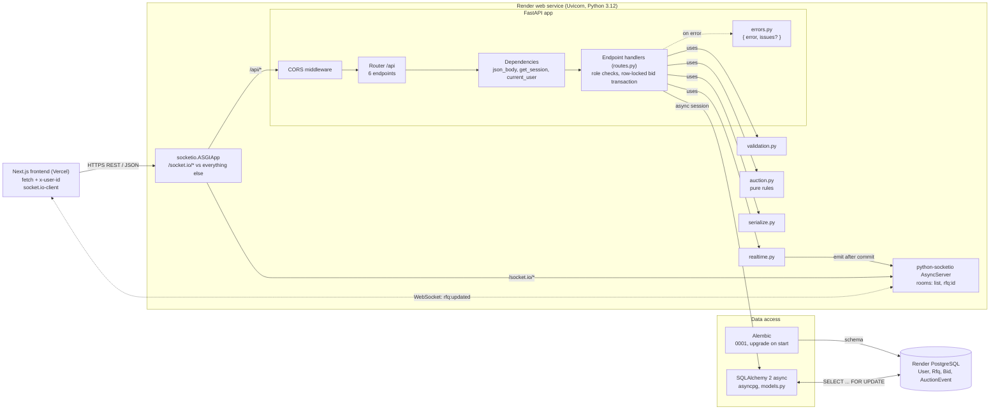
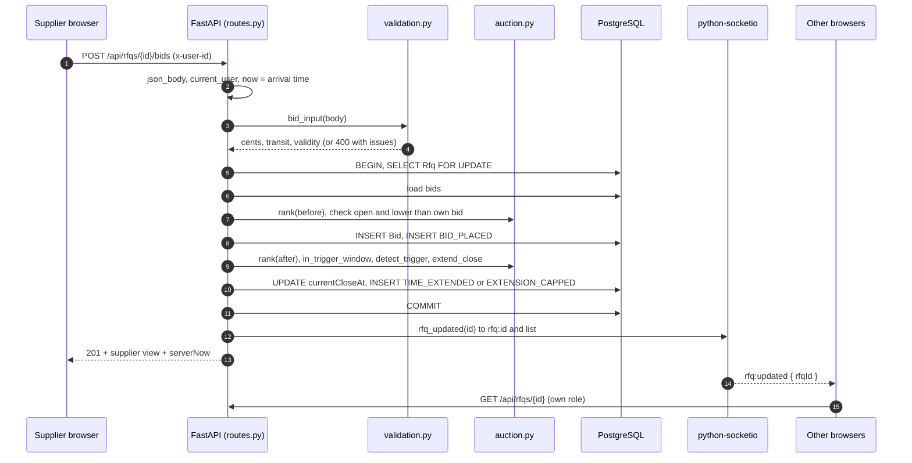

# Backend Architecture Diagram Prompt

A self-contained description of the **Python backend** (`backend-py/`), written to be pasted into a diagramming tool (Eraser.io DiagramGPT, Excalidraw AI, Lucidchart AI, Whimsical, Napkin, draw.io AI, ChatGPT/Claude with image or Mermaid output). It zooms in on the API service: how a request travels through FastAPI, where the auction rules live, how live updates are pushed, and how the service is built and deployed.

For the whole-system picture (browsers, Vercel, Render), see [`architecture.png`](architecture.png).

- **Section 1** is the ready-to-paste prompt.
- **Section 2** is the exact component and connection list, for tools that want structured input or for drawing by hand.
- **Section 3** is Mermaid code that renders in GitHub, mermaid.live, Notion or draw.io (Arrange > Insert > Advanced > Mermaid).

---

## 1. Paste-ready prompt

> Draw a clean, professional **backend architecture diagram** for the API of a **"British Auction RFQ System"**: suppliers compete in a live reverse auction on freight quotes, bids near the end extend the auction, and a forced close time caps it. The API is a **Python 3.12 FastAPI** service on **Render**, with **PostgreSQL** and **Socket.IO** live updates. The frontend (Next.js on Vercel) is outside the diagram, shown only as one client box.
>
> **Layout:** left to right, four labelled zones, with a numbered "bid request" strip below and a small "build and deploy" strip at the bottom.
>
> **Zone 1, "Clients":** one box, "Next.js frontend (Vercel) in the browser", with two notes: "REST: fetch with x-user-id header" and "socket.io-client: joins rooms list and rfq:<id>".
>
> **Zone 2, "Render web service: one Uvicorn process (ASGI)":** a large container. At its left edge, a narrow box **"socketio.ASGIApp (router)"** that splits traffic:
> - path `/socket.io/*` → "python-socketio AsyncServer"
> - everything else → "FastAPI app"
>
> Inside the "FastAPI app" box, draw the request pipeline top to bottom as stacked boxes connected by arrows:
> 1. "CORS middleware" (allowed origins from FRONTEND_ORIGIN)
> 2. "Router /api" (6 endpoints: GET /health, GET /users, GET /rfqs, POST /rfqs, GET /rfqs/{id}, POST /rfqs/{id}/bids)
> 3. "Dependencies" (three small chips side by side: "json_body: parse JSON, reject malformed", "get_session: async DB session", "current_user: x-user-id → User, 401 if unknown")
> 4. "Endpoint handlers (routes.py)" (emphasized, dark fill): role checks (buyer creates, supplier bids), role-shaped details, bid transaction under a row lock
> 5. "Error handlers (errors.py)": every error becomes { error, issues? } with 400 / 401 / 403 / 404 / 409
>
> To the right of the handlers, a column of four module boxes, each with an arrow from the handlers labelled "uses":
> - "validation.py": request rules and field error messages; forced close must be later than bid close
> - "auction.py (pure rules)": rank(), in_trigger_window(), detect_trigger(), extend_close(), status(); no DB, no clock, unit-tested with pytest
> - "serialize.py": rows to camelCase JSON, ISO timestamps, money as strings
> - "realtime.py": rfq_updated() emits to rooms rfq:<id> and list
>
> The "python-socketio AsyncServer" box sits below the FastAPI app, labelled "rooms: list, rfq:<id>; payload { rfqId } only". Arrow from "realtime.py" to it, labelled "emit after commit".
>
> **Zone 3, "Data access":** two boxes stacked.
> - "SQLAlchemy 2 async (db.py + models.py)": async engine on asyncpg; models User, Rfq, Bid, AuctionEvent
> - "Alembic migrations": revision 0001 creates the schema; runs on every start (alembic upgrade head)
>
> **Zone 4, "Render PostgreSQL":** a database cylinder listing tables: User, Rfq (row-lock target), Bid (append-only), AuctionEvent (append-only activity log), alembic_version.
>
> **Arrows:**
> 1. Client → socketio.ASGIApp, labelled "HTTPS: REST / JSON".
> 2. Client ↔ python-socketio AsyncServer, **dashed**, double-headed, labelled "WebSocket: join / leave, rfq:updated".
> 3. Endpoint handlers → SQLAlchemy, labelled "async session, transaction".
> 4. SQLAlchemy ↔ PostgreSQL, double-headed, labelled "asyncpg; SELECT ... FOR UPDATE per RFQ".
> 5. Alembic → PostgreSQL, labelled "schema".
>
> **Below the zones**, a horizontal strip titled **"POST /api/rfqs/{id}/bids"** with 8 numbered steps connected by arrows:
> 1. Parse body and identify supplier (json_body, current_user)
> 2. Validate (validation.py); stamp arrival time
> 3. Lock the auction (BEGIN; SELECT Rfq FOR UPDATE)
> 4. Check open (start ≤ now < current close) and lower than own last bid
> 5. Insert Bid and BID_PLACED event; re-rank (auction.py)
> 6. In the last X minutes and trigger fired? close = min(close + Y, forced close); log TIME_EXTENDED or EXTENSION_CAPPED
> 7. COMMIT
> 8. Emit rfq:updated; return 201 with the supplier's view
>
> **Bottom strip, "Build and deploy":** four small boxes left to right: "git push to GitHub (main)" → "Render build: pip install -r requirements.txt (Python 3.12.15)" → "Start: alembic upgrade head" → "uvicorn app.main:asgi on $PORT; health check /api/health". Add a note: "Config from env: DATABASE_URL (from the Render database), FRONTEND_ORIGIN".
>
> **Style:** light background, white boxes with thin black outlines, black text, one dark-filled emphasis box (Endpoint handlers), rounded corners, a sans-serif font, no gradients, no 3D, no clip-art. Label every arrow.

---

## 2. Structured spec

### Groups and nodes

| Group | Node id | Label | Details |
|---|---|---|---|
| Clients | `fe` | Next.js frontend (Vercel) | REST with `x-user-id`; socket.io-client joins `list`, `rfq:<id>` |
| Render web service | `asgi` | socketio.ASGIApp | Routes `/socket.io/*` to Socket.IO, everything else to FastAPI |
| Render web service | `sio` | python-socketio AsyncServer | Rooms `list`, `rfq:<id>`; payload `{ rfqId }` only |
| FastAPI app | `cors` | CORS middleware | Origins from `FRONTEND_ORIGIN` |
| FastAPI app | `router` | Router `/api` | 6 endpoints (below) |
| FastAPI app | `deps` | Dependencies | `json_body`, `get_session`, `current_user` |
| FastAPI app | `handlers` | Endpoint handlers (`routes.py`) | Role checks, role-shaped responses, bid transaction + row lock |
| FastAPI app | `errors` | Error handlers (`errors.py`) | `{ error, issues? }`; 400 / 401 / 403 / 404 / 409 |
| Modules | `validation` | `validation.py` | Request rules and messages |
| Modules | `auction` | `auction.py` | `rank`, `in_trigger_window`, `detect_trigger`, `extend_close`, `status` |
| Modules | `serialize` | `serialize.py` | camelCase JSON, ISO timestamps, money strings |
| Modules | `realtime` | `realtime.py` | `rfq_updated()` broadcast |
| Data access | `orm` | SQLAlchemy 2 async | `db.py` (asyncpg engine), `models.py` |
| Data access | `alembic` | Alembic | Revision `0001`; `alembic upgrade head` on start |
| Render PostgreSQL | `db` | PostgreSQL | `User`, `Rfq`, `Bid`, `AuctionEvent`, `alembic_version` |
| Build and deploy | `push` | git push (main) | GitHub |
| Build and deploy | `build` | Render build | `pip install -r requirements.txt`, Python 3.12.15 |
| Build and deploy | `start` | Start | `alembic upgrade head && uvicorn app.main:asgi --port $PORT` |

### Edges

| From | To | Style | Label |
|---|---|---|---|
| `fe` | `asgi` | solid | HTTPS: REST / JSON |
| `fe` | `sio` | dashed, both directions | WebSocket: join / leave, `rfq:updated` |
| `asgi` | `cors` | solid | `/api/*` |
| `asgi` | `sio` | solid | `/socket.io/*` |
| `cors` | `router` | solid | |
| `router` | `deps` | solid | |
| `deps` | `handlers` | solid | |
| `handlers` | `errors` | solid | on error |
| `handlers` | `validation`, `auction`, `serialize`, `realtime` | solid | uses |
| `realtime` | `sio` | solid | emit after commit |
| `handlers` | `orm` | solid | async session, transaction |
| `orm` | `db` | solid, both directions | asyncpg; `SELECT ... FOR UPDATE` |
| `alembic` | `db` | solid | schema |
| `push` → `build` → `start` | | solid | deploy pipeline |

### Endpoints (optional annotation on `router`)

`GET /api/health` · `GET /api/users` · `GET /api/rfqs` · `POST /api/rfqs` (buyer) · `GET /api/rfqs/{id}` · `POST /api/rfqs/{id}/bids` (supplier). Interactive docs at `/docs`.

---

## 3. Mermaid

