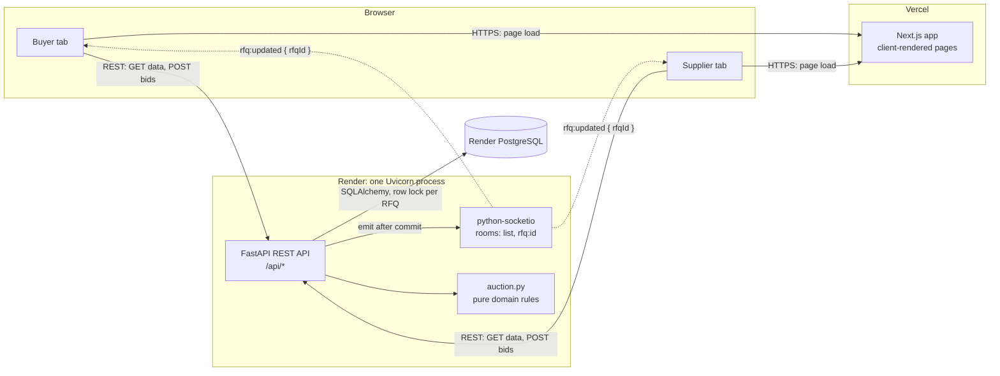
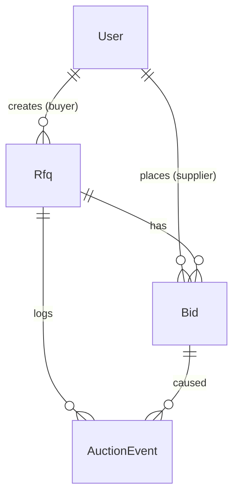
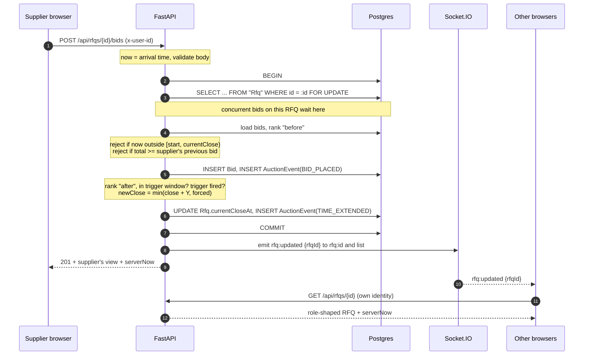
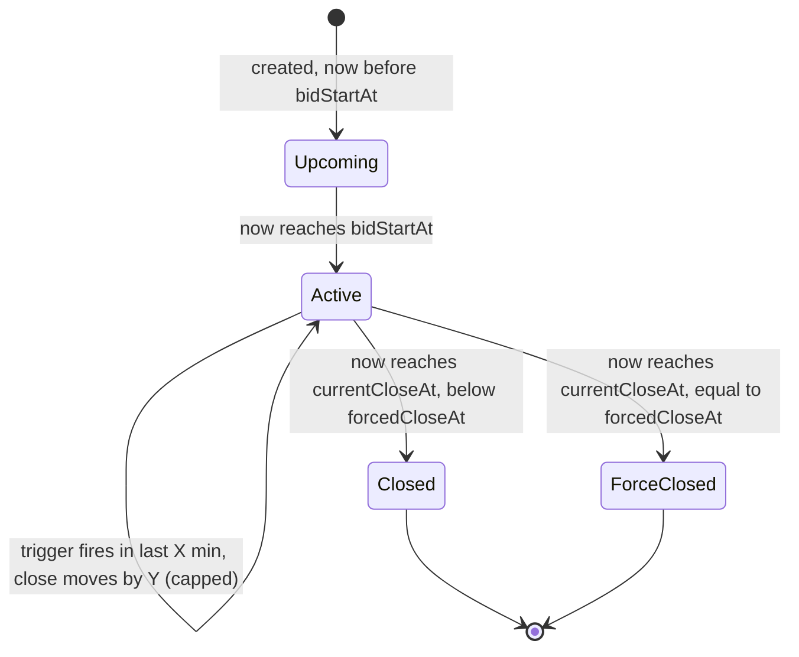
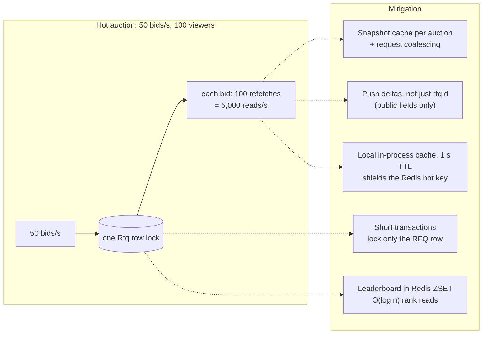
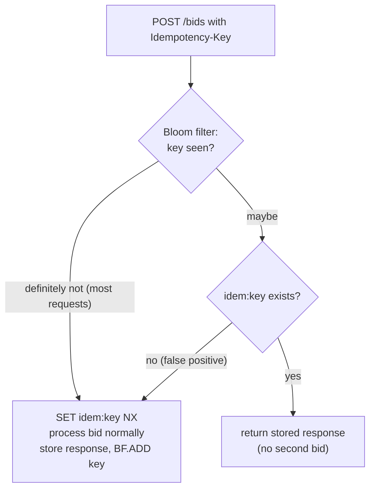
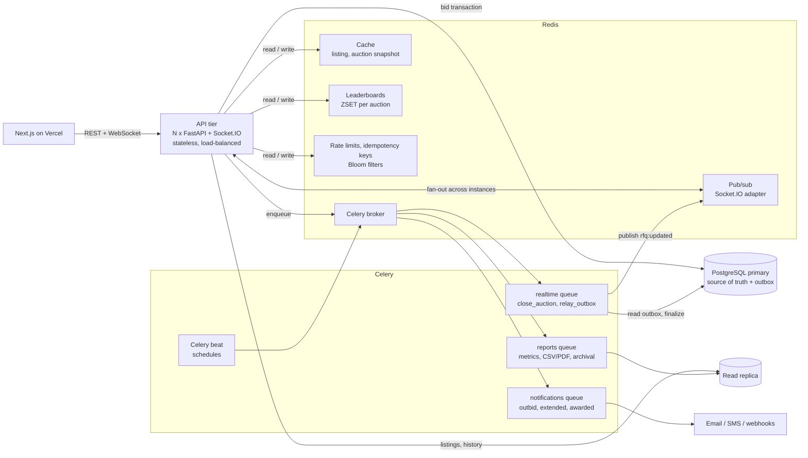
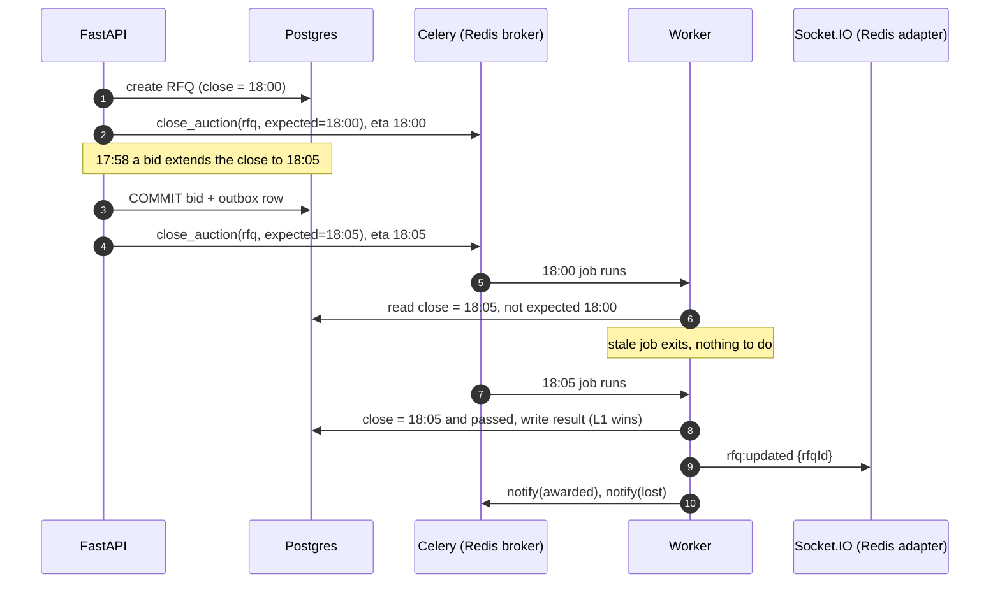
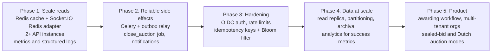

# High-Level Design: British Auction RFQ System

| | |
|---|---|
| **Status** | v1 live: Next.js on Vercel, FastAPI + Socket.IO on Render, PostgreSQL on Render |
| **Scope** | RFQ creation, British (reverse) auction bidding with auto-extension and a forced close, live updates, role-based visibility |
| **Updated** | 2026-10-23 |
| **Related** | [Database schema](SCHEMA.md) · [Backend diagram prompt](BACKEND_ARCHITECTURE_PROMPT.md) · API docs at [`/docs`](https://british-auction-api-zbjx.onrender.com/docs) |

Every capability below is labelled **Built** (running in v1) or **Planned** (designed, not built), so the document can be read as both a description of the system and its roadmap.

---

## 0. Summary

- **What it is:** buyers publish freight RFQs; suppliers compete by lowering quotes. A bid in the last **X** minutes that matches the auction's trigger (any bid, any rank change, or a new L1) moves the close **Y** minutes later, never past the **forced close**.
- **Core design choice:** PostgreSQL is the single source of truth, and **one row lock per auction** serializes bids. The server clock decides; the UI timer is display-only.
- **Live updates** are pushed over Socket.IO as `{ rfqId }` only. Clients refetch over REST with their own identity, so role-based visibility is enforced in exactly one place.
- **Status is derived, never stored**, so no scheduler is needed for correctness and nothing breaks on restart.
- **Next step for scale:** add **Redis** (Socket.IO fan-out across instances, caching, leaderboards, rate limits, idempotency with a Bloom filter) and **Celery** (auction-close jobs, notifications, an outbox relay, analytics). See [§13](#13-roadmap-redis-celery-and-beyond).

---

## 1. Context, goals and non-goals

**Problem.** In a fixed-deadline reverse auction, suppliers wait and undercut in the last seconds ("sniping"), so others can't respond and the buyer leaves money on the table. Auto-extension removes the incentive; a forced close keeps the auction bounded.

| Goals | Non-goals (v1) |
|---|---|
| Fair, transparent competition with automatic extensions | Real authentication (mocked with `x-user-id`) |
| Configurable behaviour per auction (X, Y, trigger type) | Awarding, contracts, payments |
| Correct under concurrent bids, never past the forced close | Multi-currency, multi-tenant organisations |
| Clear, live visibility of auction progress | Email/SMS notifications (in-app toasts only) |

**Success metrics** (from the brief): more bids per RFQ, and better final prices than non-extended auctions. Both are computable from `Bid` and `AuctionEvent`; a nightly analytics job is planned ([§13.3](#133-celery-tasks-planned)).

---

## 2. Requirements

### Functional

| # | Requirement | Status |
|---|---|---|
| F1 | Buyer creates an RFQ: name, reference ID, bid start, bid close, forced close (later than close), pickup date, X, Y, trigger type | Built |
| F2 | Supplier submits a quote: carrier, freight / origin / destination charges, transit time, validity; may lower it repeatedly | Built |
| F3 | Extension: a bid inside the last X minutes that matches the trigger moves the close by Y, capped at the forced close | Built |
| F4 | Listing: name/ID, lowest bid, current close, forced close, status | Built |
| F5 | Details: all bids sorted by price, L1/L2/L3 ranking, quote details, X/Y, activity log with extension reasons | Built |
| F6 | Live updates and notifications for bids, extensions, outbids | Built |

### Non-functional

| Quality | Target | How |
|---|---|---|
| Correctness | No bid accepted after close; never past forced close; no lost extension under concurrency | Row lock per RFQ; server-time checks inside the transaction |
| Latency | Bid round trip p95 < 300 ms; live update to other viewers < 1 s | Single short transaction; push `{ rfqId }`, refetch |
| Availability | 99.9% for the API | Stateless API, managed Postgres, health-checked deploys |
| Consistency | Strong for bids and close times; eventual (sub-second) for viewers | Postgres transaction; Socket.IO push + refetch |
| Security | Suppliers never see competitor identities or quotes | Responses shaped by role in one function; broadcasts carry no data |
| Operability | Zero-downtime deploys; safe migrations | Render health checks; Alembic migrations in one transaction |

---

## 3. Capacity estimates (design targets)

v1 runs one API instance, which is ample for the demo. These numbers size the planned scale-out; they are assumptions, not measurements.

| Quantity | Assumption | Result |
|---|---|---|
| Auctions | 10,000 RFQs/day, 15 suppliers each, ~25 bids per RFQ | 250,000 bids/day ≈ **3 bids/s average** |
| Peak | 70% of bids land in the last 10 minutes; closes cluster at round hours | **~150 bids/s** platform-wide at peak |
| Hot auction | One popular RFQ in its final minutes | **20–50 bids/s on a single row** (the hot key, [§9.1](#91-hot-keys-and-hot-auctions)) |
| Read fan-out | Each bid triggers a refetch by every viewer; 100 viewers on a hot auction | 50 bids/s × 100 = **5,000 reads/s** for one RFQ |
| Storage | ~250 B per bid row, ~300 B per event row | ~140 MB/day, ~50 GB/year before archival |
| Sockets | 20,000 concurrent viewers at peak | Needs several API instances, hence Socket.IO over Redis pub/sub |

The two pressure points are **writes contending on one auction** and **read fan-out after every bid**. Both drive the roadmap.

---

## 4. Architecture (v1, Built)

Source: [`architecture.svg`](architecture.svg). For the backend internals (FastAPI request pipeline, modules, data access, deploy), see [`BACKEND_ARCHITECTURE_PROMPT.md`](BACKEND_ARCHITECTURE_PROMPT.md).

| Component | Responsibility |
|---|---|
| **Next.js (Vercel)** | UI only. Client components call the API, keep a server-synced clock and listen on Socket.IO. |
| **FastAPI (Render)** | Validation, mock auth, role-shaped responses, the bid transaction. The only component that decides whether a bid counts. OpenAPI docs at `/docs`. |
| **`auction.py`** | Pure functions: ranking, trigger detection, extension math, status. No DB and no clock, so unit-tested in isolation. |
| **python-socketio** | Push channel mounted in the same ASGI app. Broadcasts carry **only the RFQ id**; clients refetch with their own identity. |
| **PostgreSQL** | Source of truth. Alembic-managed schema. One row lock per RFQ serializes bids. |

**Why Render for the API:** Vercel functions are serverless and can't hold WebSockets open; Render runs a long-lived process.

---

## 5. Data model (Built)

- `Rfq` holds the configuration (X, Y, trigger) and three close times: `bidCloseAt` (original), `currentCloseAt` (moves on extension), `forcedCloseAt` (cap). It is also the **lock target**.
- `Bid` and `AuctionEvent` are **append-only**: a revised quote is a new row, so the full history and audit trail are kept.
- Indexes: `Bid(rfqId, supplierId, createdAt)`, `AuctionEvent(rfqId, createdAt)`, unique `Rfq.refId`.

Full detail: [SCHEMA.md](SCHEMA.md).

---

## 6. Key flows (Built)

### 6.1 Bid placement (the critical path)

### 6.2 Auction lifecycle

Status is computed from timestamps on every read, so transitions need no job. A close job is planned only for side effects such as awarding and emails ([§13.3](#133-celery-tasks-planned)).

### 6.3 Auction rules

| Rule | Implementation |
|---|---|
| Bid window | `bidStartAt <= now < currentCloseAt`. A bid exactly at close is late. |
| Trigger window | `currentCloseAt - X <= now < currentCloseAt`, measured from the **current** close, so it moves with each extension. |
| Extension | `newClose = min(currentCloseAt + Y, forcedCloseAt)`, matching the spec (6:00 PM → 6:05 PM). |
| Forced close | Never exceeded. At the cap, a fired trigger is logged as `EXTENSION_CAPPED` and nothing moves. |
| Ranking | Each supplier's latest (and lowest) bid, sorted by total; ties go to whoever bid that price first. |
| Bid improvement | A new bid must beat the supplier's **own** previous bid, not L1, which keeps L2/L3 meaningful and the three triggers distinct. |

| Trigger | Fires when | Does not fire when |
|---|---|---|
| `BID_RECEIVED` | Any accepted bid inside the window | (always fires in the window) |
| `ANY_RANK_CHANGE` | A previously ranked supplier's rank changes | A newcomer enters at the bottom; L1 lowers their own price; the first bid |
| `L1_CHANGE` | The lowest bidder becomes a different supplier | L1 lowers their own price; the first bid |

---

## 7. Consistency and timer integrity (Built)

1. **The server clock decides.** Every bid is checked against server time inside the transaction. A laggy browser showing "0:01 left" is rejected if the server says the auction has closed.
2. **Clock-skew correction.** Every response includes `serverNow`; the client ticks from `Date.now() + offset`. Changing the computer's clock has no effect.
3. **Arrival-time stamping.** A bid is timestamped when the request arrives, before waiting for the lock. Close times only move later, so this never admits a late bid and never penalizes a bid for queueing.
4. **Serialization.** `SELECT ... FOR UPDATE` on the RFQ row means two simultaneous bids can't both read the old close time or ranking. Verified: four identical concurrent bids from one supplier produce exactly one acceptance and one extension chain.
5. **Self-healing UI.** At zero the client refetches; on socket reconnect it rejoins its room and refetches.

---

## 8. Visibility and notifications (Built)

| Data | Buyer | Supplier |
|---|---|---|
| Auction config, times, status, L1 price | Yes | Yes |
| All suppliers' quotes, names, ranks, full bid history | Yes | No |
| Own quotes and own rank | n/a | Yes |
| Activity log | Full, with names | Own bids in full; competitors as "A competitor placed a bid"; extensions show the trigger type only |

Shaping happens in one function (`details()` in `backend-py/app/routes.py`), and broadcasts carry no data, so there is no second path that could leak. Toasts diff fresh REST data against what the client saw last (new bid, outbid, extension, forced cap reached, bidding open or closed), so they inherit the same visibility rules.

---

## 9. Scalability deep dive

### 9.1 Hot keys and hot auctions

**Problem.** A popular auction in its final minutes concentrates traffic on a single key: one RFQ row (write contention on the lock), one cache key, one Socket.IO room, and a refetch storm after every bid ([§3](#3-capacity-estimates-design-targets)).

| Technique | Effect | Status |
|---|---|---|
| Lock scope = one RFQ row, transaction does no network I/O | Different auctions never contend; a hot auction's lock is held for milliseconds | Built |
| Emit after commit, payload `{ rfqId }` only | Small, cacheable broadcast; no per-viewer serialization on the write path | Built |
| **Auction snapshot cache** `auction:{id}:snapshot` (public fields, TTL 1–2 s, invalidated on commit) with **request coalescing** (single-flight: one DB read per key per instant) | 5,000 reads/s become ~1 DB read per update | Planned |
| **Role-split payloads**: push the public part (close time, L1 price, bid count) in the broadcast; viewers refetch only the private part | Halves refetch traffic; first paint of an extension needs no request | Planned |
| **Leaderboard per auction** in a Redis sorted set (`ZADD auction:{id}:board <total> <supplierId>`) | Rank and L1 reads without scanning bids | Planned |
| **Hot-key shielding**: 1 s local cache in each API instance in front of Redis; Redis Cluster hash tags `{rfq:id}` keep one auction's keys on one shard | Stops one Redis shard melting under a single key | Planned |
| **Per-auction ordering at extreme load**: route bids for one RFQ to one partition (Celery queue or Redis Stream keyed by `rfqId`) so a single consumer applies them in order | Removes lock contention entirely for the hottest auctions | Planned (only if lock wait p95 > 50 ms) |

### 9.2 Bloom filters

A Bloom filter answers "definitely not seen" or "maybe seen" in constant memory. It is never the source of truth here; a "maybe" always falls through to an authoritative check, so a false positive costs one extra lookup and never a wrong answer.

| Use | Filter | Authoritative check behind it | Status |
|---|---|---|---|
| **Idempotent bid submission**: a retried request (double click, network retry) must not create two bids | `bf:idem` of `Idempotency-Key` headers (RedisBloom `BF.EXISTS` / `BF.ADD`) | `SET idem:{key} NX EX 86400` holding the first response; replayed on a hit | Planned |
| **Reference ID pre-check** on the create form (live "ID taken" hint while typing) | `bf:refid` of existing reference IDs | Unique index `Rfq_refId_key` (already returns 409) | Planned |
| **Notification de-duplication** in Celery fan-out (don't email "outbid" twice for one event) | `bf:notified:{day}` of `eventId:userId` | `Notification` table with a unique key | Planned |

Sizing: 10 million keys at a 1% false-positive rate need about 12 MB, with 7 hash functions. Filters rotate daily so expired keys age out.

### 9.3 Caching strategy (Planned)

| Data | Cache | TTL / invalidation | Why |
|---|---|---|---|
| Auction listing | `rfqs:list:{role}` | 2 s, invalidated on any `rfq:updated` | Hit on every page load and every broadcast |
| Auction public snapshot | `auction:{id}:snapshot` | 1–2 s, invalidated on commit | Hot-key read storm |
| Users | `users` | 1 h | Static demo data |
| Role-private views (a supplier's own bids) | not cached | n/a | Small, per-user, must be exact |

The write path never reads from cache: the bid transaction always reads Postgres under the lock.

### 9.4 Scaling out

| Concern | Approach | Status |
|---|---|---|
| More API instances | Stateless FastAPI behind Render's load balancer; sticky sessions not required | Ready |
| Broadcasts across instances | `socketio.AsyncRedisManager` (Redis pub/sub) so an emit on one instance reaches sockets on all | Planned |
| Read load | Postgres read replica for listings and history; writes stay on the primary | Planned |
| Event table growth | Partition `AuctionEvent` and `Bid` by month; archive closed auctions older than 12 months to object storage | Planned |
| Connection limits | PgBouncer in transaction mode in front of Postgres | Planned |

---

## 10. Reliability

| Failure | v1 behaviour | Planned hardening |
|---|---|---|
| Crash between COMMIT and emit | Bid is safe; viewers miss one push but resync on their next refetch or reconnect | **Transactional outbox**: write the event row in the same transaction; a Celery relay publishes it (at-least-once) |
| Client disconnects | Socket.IO reconnects, rejoins the room, refetches | — |
| API restart or deploy | Status is derived, so nothing to recover; Render swaps instances after the health check passes | — |
| Bad migration | Alembic runs in one transaction; a failure rolls back and the previous version keeps serving | — |
| Database loss | Render managed backups | Point-in-time recovery drills; read replica for failover |
| Duplicate submissions | Rejected by the own-bid rule if not lower | Idempotency keys + Bloom filter ([§9.2](#92-bloom-filters)) |

Targets: API availability 99.9%; RPO ≤ 5 min, RTO ≤ 30 min (with PITR).

---

## 11. Security

| Area | v1 (Built) | Planned |
|---|---|---|
| Authentication | Mock: `x-user-id` header (documented as an API key in Swagger) | OIDC / JWT; the `current_user` dependency is the single swap point |
| Authorization | Role checks per endpoint; responses shaped by role in one function | Per-organisation tenancy; buyers see only their own RFQs |
| Input | Strict validation with field-level errors; JSON only; money handled as integer paise | — |
| Transport and origin | HTTPS; CORS and Socket.IO limited to the Vercel origin | — |
| Abuse | — | Rate limits in Redis (token bucket per user and per IP; stricter on `POST /bids`) |
| Audit | Append-only `Bid` and `AuctionEvent` | Signed export of the activity log for disputes |
| Secrets | Environment variables on Render and Vercel; `.env` files git-ignored | Secret rotation runbook |

---

## 12. Observability

| Signal | v1 (Built) | Planned |
|---|---|---|
| Health | `/api/health`, used by Render's health check | Synthetic check placing a bid on a canary auction |
| Logs | Uvicorn access logs on Render | Structured JSON logs with request id, user id, rfq id |
| Metrics | — | Prometheus: bids/s, accepted vs rejected, **lock wait time**, extensions per auction, socket connections, cache hit rate |
| Tracing | — | OpenTelemetry across API → DB → Redis → Celery |
| Alerts | — | Lock wait p95 > 50 ms, 5xx rate > 1%, Celery queue lag > 5 s |

---

## 13. Roadmap: Redis, Celery and beyond

### 13.1 Target architecture (Planned)

### 13.2 How Redis will be used

| Role | Keys / feature | Replaces or adds |
|---|---|---|
| Socket.IO across instances | `socketio.AsyncRedisManager` pub/sub channel | Lets the API scale past one instance |
| Cache | `rfqs:list:{role}`, `auction:{id}:snapshot` | Absorbs read fan-out ([§9.3](#93-caching-strategy-planned)) |
| Leaderboard | `auction:{id}:board` sorted set | Fast rank/L1 reads; Postgres stays authoritative |
| Rate limiting | `rl:{user}:{route}` token buckets (Lua script) | Abuse protection |
| Idempotency | `idem:{key}` with `NX`, plus `bf:idem` Bloom filter | Safe client retries ([§9.2](#92-bloom-filters)) |
| Celery broker and results | Redis lists / streams | Background jobs |

Redis is never the source of truth for bids or close times; losing Redis degrades performance, not correctness.

### 13.3 Celery tasks (Planned)

| Task | Queue | Trigger | What it does |
|---|---|---|---|
| `close_auction(rfq_id, expected_close)` | realtime | Scheduled with `eta = currentCloseAt` at creation; re-scheduled on every extension | If the stored close still equals `expected_close` and has passed: write the result (winner = L1), emit `rfq:updated`, enqueue award notifications. Stale jobs see a newer close and exit (idempotent). |
| `relay_outbox()` | realtime | Beat every second (or Postgres `LISTEN/NOTIFY`) | Publishes committed outbox rows to Socket.IO and notification queues; marks them sent. Guarantees no lost broadcast. |
| `notify(event_id)` | notifications | Enqueued by the relay | Outbid, extended, closing soon, awarded; de-duplicated with the Bloom filter; retries with exponential backoff |
| `closing_soon_reminders()` | notifications | Beat every minute | Nudges suppliers on auctions entering their last X minutes |
| `compute_metrics()` | reports | Beat nightly | **Success metrics from the brief**: bids per RFQ, price improvement of extended vs non-extended auctions, extension counts |
| `export_report(rfq_id, format)` | reports | On demand | CSV/PDF of the ranking and activity log, emailed or stored |
| `archive_closed_auctions()` | reports | Beat weekly | Moves old partitions to cold storage |

### 13.4 Phased plan

| Phase | Exit criteria |
|---|---|
| 1 | Two API instances serve one auction with consistent live updates; listing p95 < 100 ms under 5,000 reads/s |
| 2 | Killing an instance mid-bid loses no broadcast; auctions close and notify within 2 s of the final close |
| 3 | Retried bid requests never double-insert; abusive clients are throttled |
| 4 | 12 months of history queryable; nightly report of bids per RFQ and price improvement |
| 5 | Buyers award from the UI; organisations isolated |

---

## 14. Key decisions

| Decision | Chosen | Alternatives considered | Why |
|---|---|---|---|
| Concurrency control | Pessimistic row lock per RFQ | Optimistic version column with retries; Redis lock | Contention is per auction and short; a lock gives exactly-once extension logic with no retry storms. Revisit with per-auction partitions if lock wait grows. |
| Source of truth | PostgreSQL only | Redis as the live auction state | Durability and transactions matter more than microseconds; Redis is added later as a cache and broker only. |
| Status | Derived on read | Stored column flipped by a scheduler | No job is needed for correctness; can't go stale. |
| Push payload | `{ rfqId }` only, clients refetch | Push full state per viewer | One place enforces visibility; nothing private on the wire. |
| Realtime transport | Socket.IO | Server-sent events; raw WebSockets | Rooms, reconnection and a fallback for free; one client library. |
| Bid rule | Must beat own previous bid | Must beat L1 | Keeps L2/L3 meaningful and the three trigger types distinct. |
| Extension base | Current close + Y | Bid time + Y | Matches the brief's example (6:00 → 6:05). |
| Backend stack | FastAPI + SQLAlchemy + Alembic | Node/Express + Prisma (v0) | Migrated with identical API contracts, verified response-for-response. |

---

## 15. Assumptions and open questions

**Assumptions:** auth is mocked; currency is INR stored as `Decimal(12,2)` and compared as integer paise; total price = freight + origin + destination; pickup date on or after the forced close date; quote validity not in the past; an RFQ's start may be in the past but its close must be in the future; calendar dates are UTC midnight, timestamps UTC and shown in local time.

**Open questions:** should a supplier be allowed to withdraw a bid? Should ties at the forced close be broken by transit time rather than bid time? Should suppliers see the L1 price, or only their own rank (stricter sealed variant)?

---

## Glossary

| Term | Meaning |
|---|---|
| RFQ | Request for Quotation: one auction |
| L1, L2, L3 | Rank by total price; L1 is the lowest |
| X | Trigger window: minutes before the current close in which activity is watched |
| Y | Extension: minutes added when the trigger fires |
| Forced close | Hard cap; the auction never runs past it |
| Hot key | A single key (row, cache entry, room) receiving a disproportionate share of traffic |
| Bloom filter | Probabilistic set: "definitely not present" or "maybe present", in fixed memory |
| Outbox | Events written in the same transaction as the data, published afterwards by a relay |
