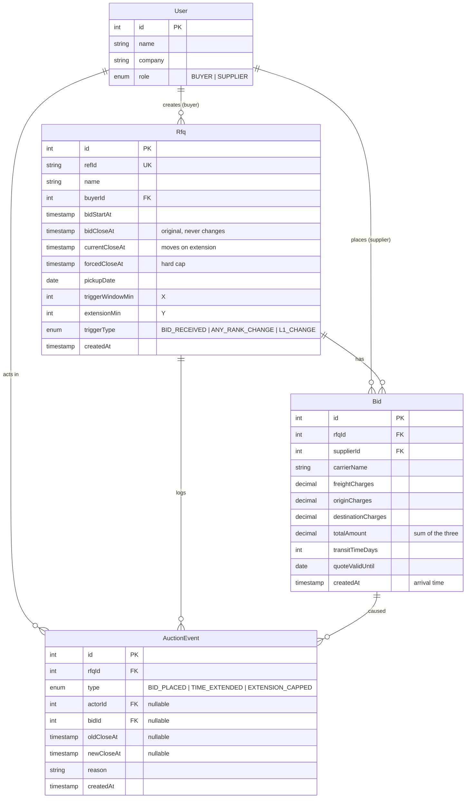

# Database Schema

PostgreSQL. Models: [`backend-py/app/models.py`](../backend-py/app/models.py) (SQLAlchemy). Migrations: [`backend-py/alembic/versions`](../backend-py/alembic/versions) (Alembic); `0001` creates the schema below.

## Tables

### `User`
Seeded demo accounts. `role` decides what the API returns and which actions are allowed (buyers create RFQs, suppliers bid).

### `Rfq`
One row per auction. Holds the auction configuration (X, Y, trigger type) next to its times.

- `bidCloseAt` keeps the **original** close, so the UI can show how far the auction was extended.
- `currentCloseAt` is the live close time. It only changes inside the bid transaction, under a row lock, and it is never greater than `forcedCloseAt`.
- This row is also the **lock target**: `SELECT ... FOR UPDATE` on it serializes bids for that RFQ.

### `Bid`
Append-only. A supplier's revised quote is a new row, never an update, so the full bid history is kept.

- `totalAmount` is stored (not computed on read) so the listing can take `MIN(totalAmount)` per RFQ in one grouped query.
- Each supplier's newest bid is always their lowest, because a new bid must beat their previous one. So `MIN(totalAmount)` per RFQ is the current L1 price.

### `AuctionEvent`
Append-only activity log behind the "Activity" panel.

- `BID_PLACED`: every accepted bid.
- `TIME_EXTENDED`: has `oldCloseAt`/`newCloseAt` and a human-readable `reason` naming the cause (e.g. "L1 changed: Rahul Verma → Ananya Iyer in the last 10 min → extended by 5 min").
- `EXTENSION_CAPPED`: a trigger fired, but the auction was already at its forced close.
- `reason` is written for the buyer. Suppliers get a redacted version generated at read time, so competitor names never leave the server.

## Design decisions

| Decision | Why |
|---|---|
| **Status is not a column** | It is a pure function of `now`, `bidStartAt`, `currentCloseAt` and `forcedCloseAt`. Storing it would need a scheduler to flip it at the right second and could go stale. |
| `Decimal(12,2)` for money | Exact values. Comparisons in code use integer paise. |
| `DATE` columns for pickup/validity | They're calendar dates, not instants. |
| Index `Bid(rfqId, supplierId, createdAt)` | Loading an RFQ's bids, and "latest bid per supplier". |
| Index `AuctionEvent(rfqId, createdAt)` | Activity log in time order. |
| Unique `Rfq.refId` | Human reference IDs must not collide. Duplicates return a 409 shown inline on the form. |
